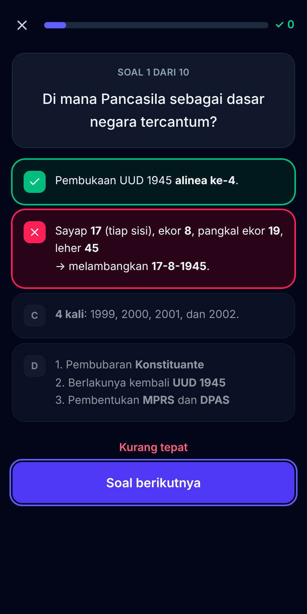

# IngatTerus 🧠

**Aplikasi belajar flashcard dengan pengulangan berjarak (spaced repetition).**
Berjalan di browser, bisa dipasang sebagai aplikasi (PWA), dan tetap bisa dipakai **tanpa internet**.
Semua data tersimpan di perangkatmu sendiri — tanpa akun, tanpa server, tanpa pelacakan.

🔗 **Coba langsung:** <https://rifqihh1689-hash.github.io/IngatTerus/>

<p align="center">
  
  
  
  
</p>

## Fitur

- **Deck & kartu** — buat deck berwarna, kartu depan/belakang dengan format **tebal**, *miring*,
  pangkat (x²), indeks (H₂O), serta **gambar** di kedua sisi (otomatis diperkecil agar hemat ruang).
- **Mode belajar** — tombol **Lupa / Sulit / Bisa / Mudah** dengan pratinjau interval berikutnya.
  Jadwal ulang dihitung otomatis memakai algoritma **FSRS-5**. Ada tombol batalkan jawaban dan
  pintasan keyboard.
- **Mode kuis** pilihan ganda dengan umpan balik langsung, dan **mode ujian berwaktu** (hitung
  mundur, navigasi soal, kumpul otomatis saat waktu habis, pembahasan di akhir).
- **Statistik** — streak harian, kartu jatuh tempo, perkiraan beban 14 hari, grafik ulasan per hari,
  kematangan kartu, tingkat ingatan (keseluruhan & per deck), dan riwayat kuis/ujian.
- **Impor** kartu dari teks/CSV/TSV dengan format `pertanyaan;jawaban` (lengkap dengan pratinjau,
  laporan baris bermasalah, dan deteksi duplikat), **ekspor** deck ke CSV, serta
  **cadangan & pulihkan JSON** untuk semua data.
- **3 deck contoh** siap pakai: Kosakata Bahasa Inggris, Pengetahuan Umum & TWK Dasar,
  dan Rumus Matematika Dasar.
- **Pengingat belajar harian** lewat notifikasi browser.
- **Antarmuka Bahasa Indonesia**, mobile-first, dengan **mode gelap** (ikut sistem, terang, atau gelap).
- **Offline & dapat dipasang** (PWA dengan service worker Workbox).

## Cara memakai

### Belajar
1. Pilih deck (atau tekan **Belajar sekarang** untuk semua deck).
2. Ingat-ingat jawabannya, lalu ketuk kartu / **Tampilkan jawaban**.
3. Nilai seberapa baik kamu mengingat:

| Tombol | Artinya | Contoh jadwal kartu baru |
| --- | --- | --- |
| **Lupa** | Tidak ingat sama sekali | diulang 1 menit lagi |
| **Sulit** | Ingat, tapi susah payah | ±6 menit |
| **Bisa** | Ingat dengan wajar | 10 menit, lalu harian |
| **Mudah** | Langsung ingat | ±16 hari |

Pintasan keyboard: `Spasi`/`Enter` = tampilkan jawaban, `1`–`4` = nilai, `U` = batalkan.

### Format teks kartu

| Tulis | Hasil |
| --- | --- |
| `**tebal**` | **tebal** |
| `*miring*` | *miring* |
| `x^2^` | x² |
| `H~2~O` | H₂O |
| `` `kode` `` | `kode` |

### Impor dari teks / CSV

Satu kartu per baris, pertanyaan dan jawaban dipisah titik koma:

```text
# baris berawalan # diabaikan
pertanyaan;jawaban
Ibu kota Jepang?;**Tokyo**
apple;apel\n*I eat an apple every day.*
"Teks berisi ; titik koma";"bungkus dengan tanda kutip"
```

- Pemisah koma (CSV) dan tab (TSV dari Excel/Google Sheets) juga didukung dan dideteksi otomatis.
- Header `pertanyaan;jawaban` (atau `front;back`, `soal;jawaban`, dst.) otomatis dilewati.
- `\n` menjadi baris baru. Teks berkutip boleh berisi baris baru asli dan `""` untuk tanda kutip.

### Cadangan JSON

**Pengaturan → Data & cadangan → Ekspor** mengunduh satu berkas JSON berisi semua deck, kartu
(termasuk gambar & jadwal), riwayat ulasan, hasil kuis, dan pengaturan. Saat memulihkan, pilih
**Gabungkan** (tambahkan ke data yang ada) atau **Ganti semua data**.

> Data disimpan di IndexedDB browser. Menghapus data situs/browser akan menghapus kartu — rutinlah
> mengunduh cadangan, terutama sebelum ganti perangkat.

### Pengingat harian

Aktifkan di **Pengaturan → Pengingat harian**, pilih jamnya, lalu izinkan notifikasi.
Notifikasi dikirim sekali sehari setelah jam tersebut, **hanya bila kamu belum belajar hari itu**.

- Saat aplikasi terbuka (termasuk di tab latar), pengingat dicek setiap menit.
- Bila IngatTerus **dipasang sebagai aplikasi** di Chrome/Edge (Android & desktop), pengingat juga
  bisa muncul saat aplikasi tertutup melalui *Periodic Background Sync*. Frekuensinya ditentukan
  browser berdasarkan seberapa sering aplikasi dipakai.
- Di iPhone/iPad, notifikasi web hanya tersedia untuk aplikasi yang ditambahkan ke Layar Utama
  (iOS 16.4+) dan *background sync* belum didukung, jadi pengingat muncul saat aplikasi dibuka.

## Algoritma penjadwalan (FSRS-5)

IngatTerus memakai [FSRS](https://github.com/open-spaced-repetition/fsrs4anki/wiki/The-Algorithm)
(*Free Spaced Repetition Scheduler*) versi 5 — algoritma modern yang juga dipakai Anki. Setiap kartu
punya tiga besaran memori:

- **Stabilitas (S)** — berapa hari sampai peluang ingat turun ke 90%.
- **Kesulitan (D)** — 1 sampai 10, naik bila sering lupa.
- **Peluang ingat (R)** — `R(t) = (1 + 19/81 · t/S)^−0,5`.

Setelah dijawab, S dan D diperbarui, lalu kartu dijadwalkan pada hari ketika R diperkirakan turun ke
**target ingatan** (bawaan 90%, bisa diubah di Pengaturan). Kartu baru melewati langkah belajar
1 & 10 menit, dan kartu yang lupa melewati langkah belajar ulang 10 menit. Interval selalu
berurutan *Sulit ≤ Bisa < Mudah*. Implementasinya ada di [`src/lib/fsrs.ts`](src/lib/fsrs.ts)
dan diuji di [`src/lib/fsrs.test.ts`](src/lib/fsrs.test.ts).

## Teknologi

- [React](https://react.dev) + [Vite](https://vite.dev) + TypeScript
- [Tailwind CSS](https://tailwindcss.com) v4
- [Dexie](https://dexie.org) (IndexedDB) dengan `useLiveQuery` untuk data reaktif
- [vite-plugin-pwa](https://vite-pwa-org.netlify.app) + Workbox (service worker `injectManifest`)
- [Vitest](https://vitest.dev) + `fake-indexeddb` untuk pengujian
- Grafik SVG buatan sendiri (tanpa pustaka grafik) dengan palet aman buta warna

## Menjalankan secara lokal

Butuh Node.js 22 atau lebih baru.

```bash
npm ci
```

```bash
npm run dev
```

Buka <http://localhost:5173>. Perintah lain:

| Perintah | Fungsi |
| --- | --- |
| `npm test` | Menjalankan semua tes Vitest sekali |
| `npm run test:watch` | Tes dalam mode pantau |
| `npm run typecheck` | Pemeriksaan tipe TypeScript |
| `npm run build` | Typecheck + build produksi ke `dist/` |
| `npm run preview` | Menyajikan hasil build secara lokal |

Service worker hanya aktif pada build produksi (`npm run build && npm run preview`).

## Deploy ke GitHub Pages

Workflow [`.github/workflows/deploy.yml`](.github/workflows/deploy.yml) menjalankan tes dan build di
setiap pull request, lalu men-deploy ke GitHub Pages setiap ada push ke `main`.

Pengaturan sekali saja di repositori GitHub:

1. Buka **Settings → Pages**.
2. Di **Build and deployment → Source**, pilih **GitHub Actions**.
3. Push ke `main` (atau jalankan workflow secara manual dari tab **Actions**).

Aplikasi akan tersedia di `https://<nama-pengguna>.github.io/<nama-repo>/`. Base path diatur otomatis
lewat variabel `BASE_PATH` di workflow; untuk build manual di sub-path lain:

```bash
BASE_PATH=/nama-repo/ npm run build
```

## Struktur proyek

```text
src/
├── lib/            # logika murni + tes: fsrs, importText, backup, quiz, stats, queue, reminder
├── db/             # skema Dexie & operasi data (repo) + tes
├── data/           # deck contoh bawaan
├── components/     # UI: tombol, modal, editor kartu, grafik, tata letak
├── pages/          # Beranda, Deck, Editor, Belajar, Kuis, Ujian, Statistik, Impor, Pengaturan
├── hooks/          # useSettings, useDeckSummaries, useStreak, useTheme
├── sw.ts           # service worker: cache offline, pengingat, klik notifikasi
└── App.tsx         # router hash & rute
```

## Privasi

IngatTerus tidak memiliki server. Tidak ada data yang dikirim ke mana pun; semuanya disimpan di
IndexedDB browser pada perangkatmu.
