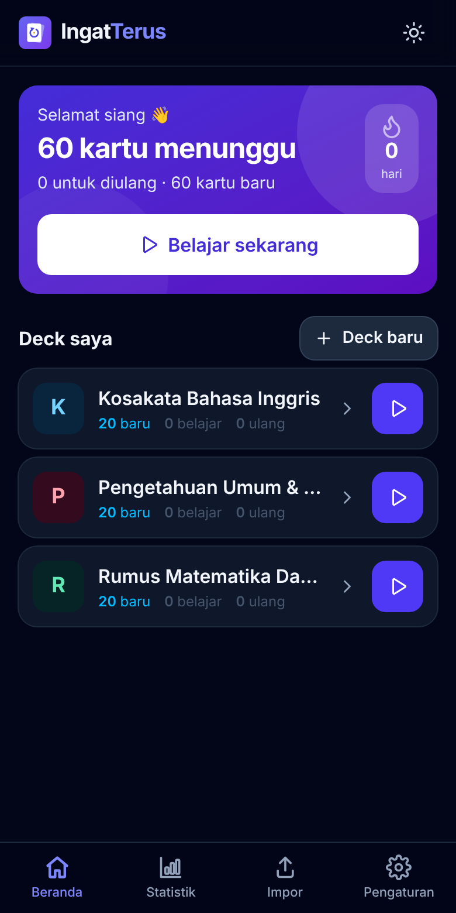
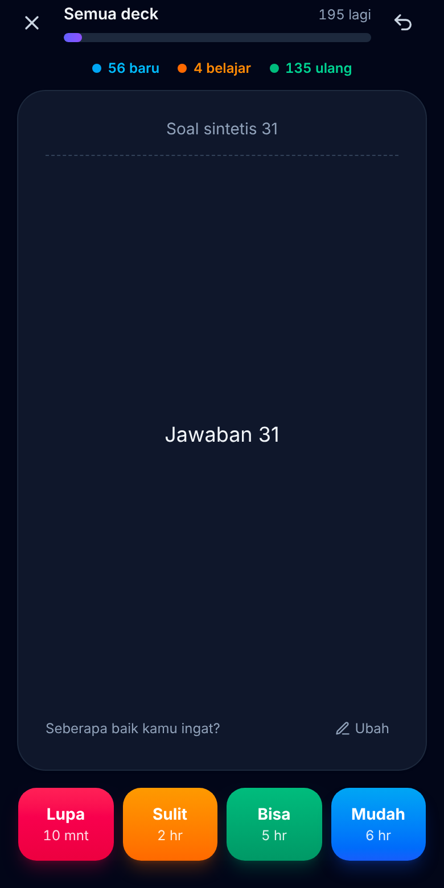
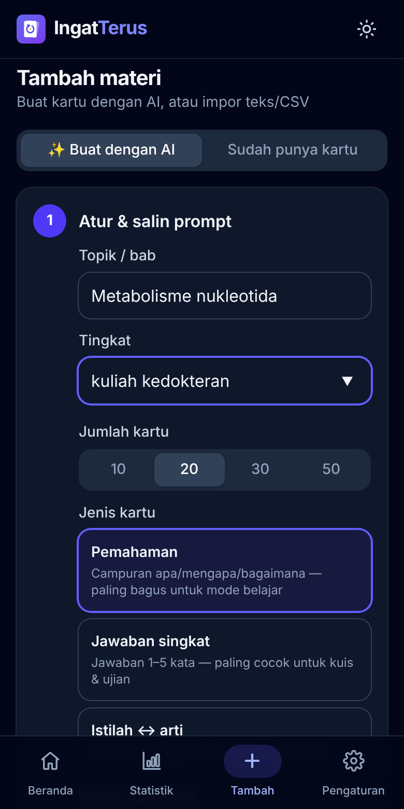
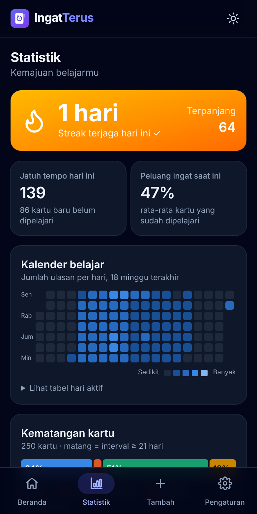

# IngatTerus 🧠

**Aplikasi belajar flashcard dengan pengulangan berjarak (spaced repetition).**
Berjalan di browser, bisa dipasang sebagai aplikasi (PWA), dan tetap bisa dipakai **tanpa internet**.
Semua data tersimpan di perangkatmu sendiri — tanpa akun, tanpa server, tanpa pelacakan.

🔗 **Coba langsung:** <https://rifqihh1689-hash.github.io/IngatTerus/>

<p align="center">
  
  
  
  
</p>

## Fitur

- **Deck & kartu** — buat deck berwarna, kartu depan/belakang dengan format **tebal**, *miring*,
  pangkat (x²), indeks (H₂O), serta **gambar** di kedua sisi (otomatis diperkecil agar hemat ruang).
- **Algoritma FSRS-6 + personalisasi** — penjadwal pengulangan berjarak paling akurat saat ini,
  dan bisa **dilatih dari riwayat belajarmu sendiri** (Pengaturan → Algoritma belajar).
- **Mode belajar** — kartu bolak-balik, tombol **Lupa / Sulit / Bisa / Mudah** dengan pratinjau
  interval, batalkan jawaban, pintasan keyboard, ringkasan sesi, dan **latihan tambahan** untuk
  kartu yang paling rawan lupa (cocok menjelang ujian).
- **Tambah materi dengan AI** — atur topik, tingkat, jumlah, dan jenis kartu, lalu salin prompt
  siap pakai untuk ChatGPT/Gemini/Claude. Jawaban AI tinggal ditempel dan diimpor.
- **Mode kuis** pilihan ganda dengan umpan balik langsung, dan **mode ujian berwaktu** (hitung
  mundur, navigasi soal, kumpul otomatis saat waktu habis, pembahasan di akhir).
- **Statistik** — streak harian, kalender aktivitas 18 minggu, kartu jatuh tempo, perkiraan beban
  14 hari, grafik ulasan per hari, kematangan kartu, tingkat ingatan (keseluruhan & per deck),
  waktu berpikir per kartu, dan riwayat kuis/ujian.
- **Impor** kartu dari teks/CSV/TSV dengan format `pertanyaan;jawaban` (lengkap dengan pratinjau,
  laporan baris bermasalah, dan deteksi duplikat), **ekspor** deck ke CSV, serta
  **cadangan & pulihkan JSON** untuk semua data.
- **3 deck contoh** siap pakai: Kosakata Bahasa Inggris, Pengetahuan Umum & TWK Dasar,
  dan Rumus Matematika Dasar.
- **Sinkron antar perangkat** — masuk dengan Google di laptop & HP: deck, kartu, riwayat, dan jadwal
  ulang selalu sama, tetap bisa offline (Firebase, penggabungan bebas konflik).
- **Pengingat belajar harian** lewat notifikasi browser.
- **Antarmuka Bahasa Indonesia**, mobile-first, dengan **mode gelap** (ikut sistem, terang, atau gelap).
- **Offline & dapat dipasang** (PWA dengan service worker Workbox).

## Cara memakai

### Belajar
1. Pilih deck (atau tekan **Belajar sekarang** untuk semua deck).
2. Ingat-ingat jawabannya, lalu ketuk kartu / **Tampilkan jawaban**.
3. Nilai seberapa baik kamu mengingat:

| Tombol | Artinya | Contoh jadwal kartu baru |
| --- | --- | --- |
| **Lupa** | Tidak ingat sama sekali | diulang 1 menit lagi |
| **Sulit** | Ingat, tapi susah payah | ±6 menit |
| **Bisa** | Ingat dengan wajar | 10 menit, lalu harian |
| **Mudah** | Langsung ingat | ±8 hari |

Pintasan keyboard: `Spasi`/`Enter` = tampilkan jawaban, `1`–`4` = nilai, `U` = batalkan.

### Format teks kartu

| Tulis | Hasil |
| --- | --- |
| `**tebal**` | **tebal** |
| `*miring*` | *miring* |
| `x^2^` | x² |
| `H~2~O` | H₂O |
| `` `kode` `` | `kode` |

### Impor dari teks / CSV

Satu kartu per baris, pertanyaan dan jawaban dipisah titik koma:

```text
# baris berawalan # diabaikan
pertanyaan;jawaban
Ibu kota Jepang?;**Tokyo**
apple;apel\n*I eat an apple every day.*
"Teks berisi ; titik koma";"bungkus dengan tanda kutip"
```

- Pemisah koma (CSV) dan tab (TSV dari Excel/Google Sheets) juga didukung dan dideteksi otomatis.
- Header `pertanyaan;jawaban` (atau `front;back`, `soal;jawaban`, dst.) otomatis dilewati.
- `\n` menjadi baris baru. Teks berkutip boleh berisi baris baru asli dan `""` untuk tanda kutip.

### Membuat deck dari materi dengan AI

Buka **Tambah → ✨ Buat dengan AI**:

1. Isi topik, tingkat, jumlah, dan jenis kartu (*Pemahaman*, *Jawaban singkat* untuk kuis/ujian,
   atau *Istilah ↔ arti*). Tempel materi bila mau, lalu tekan **Salin prompt**.
2. Tempel prompt di ChatGPT, Gemini, atau Claude. Lampirkan PDF/foto materi bila belum ditempel.
3. Salin **seluruh** jawaban AI ke kotak *Teks kartu*. Isi blok kodenya diambil otomatis. Cek
   pratinjau, lalu **Impor**.

Cicil materi per subbab (1–3 halaman per prompt) ke deck yang sama; kartu duplikat dilewati
otomatis. Prompt lengkapnya juga ada di [`docs/PROMPT-MATERI.md`](docs/PROMPT-MATERI.md).

### Sinkron antar perangkat (laptop & HP)

Buka **Pengaturan → Sinkron antar perangkat → Masuk dengan Google** di laptop, lalu lakukan hal yang
sama dengan akun Google yang sama di HP. Data laptop otomatis muncul di HP, dan sebaliknya.

- Sinkron berjalan otomatis: beberapa detik setelah ada perubahan, saat aplikasi dibuka atau kembali
  online, dan berkala selama aplikasi terbuka. Ikon awan di kanan atas menunjukkan statusnya.
- Tetap bisa belajar offline; perubahan dikirim begitu online.
- Riwayat ulasan dari semua perangkat **digabung**, lalu jadwal ulang dihitung dari riwayat gabungan
  dengan FSRS — hasilnya identik di semua perangkat, walau kartu yang sama sempat diulang di dua
  perangkat saat offline. Isi kartu & deck: suntingan terbaru yang menang. Penghapusan ikut tersinkron.

Fitur ini memakai proyek **Firebase** gratis (Auth + Firestore) yang dipasang sekali oleh pemilik
aplikasi — panduan lengkapnya di [`docs/SINKRON-FIREBASE.md`](docs/SINKRON-FIREBASE.md).
Firebase hanya dimuat bila sinkron dipakai, jadi aplikasi tetap ringan.

### Cadangan JSON

**Pengaturan → Data & cadangan → Ekspor** mengunduh satu berkas JSON berisi semua deck, kartu
(termasuk gambar & jadwal), riwayat ulasan, hasil kuis, dan pengaturan. Saat memulihkan, pilih
**Gabungkan** (tambahkan ke data yang ada) atau **Ganti semua data**.

> Data disimpan di IndexedDB browser. Menghapus data situs/browser akan menghapus kartu — rutinlah
> mengunduh cadangan, terutama sebelum ganti perangkat.

### Pengingat harian

Aktifkan di **Pengaturan → Pengingat harian**, pilih jamnya, lalu izinkan notifikasi.
Notifikasi dikirim sekali sehari setelah jam tersebut, **hanya bila kamu belum belajar hari itu**.

- Saat aplikasi terbuka (termasuk di tab latar), pengingat dicek setiap menit.
- Bila IngatTerus **dipasang sebagai aplikasi** di Chrome/Edge (Android & desktop), pengingat juga
  bisa muncul saat aplikasi tertutup melalui *Periodic Background Sync*. Frekuensinya ditentukan
  browser berdasarkan seberapa sering aplikasi dipakai.
- Di iPhone/iPad, notifikasi web hanya tersedia untuk aplikasi yang ditambahkan ke Layar Utama
  (iOS 16.4+) dan *background sync* belum didukung, jadi pengingat muncul saat aplikasi dibuka.

## Algoritma penjadwalan (FSRS-6 + personalisasi)

IngatTerus memakai [FSRS](https://github.com/open-spaced-repetition/fsrs4anki/wiki/The-Algorithm)
(*Free Spaced Repetition Scheduler*) **versi 6**, generasi terbaru algoritma yang juga dipakai Anki.
Pada benchmark terbuka [open-spaced-repetition](https://github.com/open-spaced-repetition/srs-benchmark),
FSRS memprediksi kapan kamu lupa jauh lebih akurat daripada SM-2 (algoritma klasik Anki/SuperMemo),
sehingga untuk tingkat ingatan yang sama kamu butuh lebih sedikit ulangan.

Setiap kartu punya tiga besaran memori:

- **Stabilitas (S)**: berapa hari sampai peluang ingat turun ke 90%.
- **Kesulitan (D)**: 1 sampai 10, naik bila sering lupa.
- **Peluang ingat (R)**: `R(t) = (1 + F · t/S)^(−w20)`. Kemiringan kurva lupa `w20` ikut dilatih
  di FSRS-6, dan `F` dipilih agar R(S) = 90%.

Setelah dijawab, S dan D diperbarui, lalu kartu dijadwalkan pada hari ketika R diperkirakan turun ke
**target ingatan** (bawaan 90%, bisa diubah di Pengaturan). Detail lain:

- **Langkah belajar**: kartu baru diulang 1 & 10 menit dulu; kartu yang lupa diulang lagi 10 menit kemudian.
  Ulangan di hari yang sama memakai rumus stabilitas jangka pendek FSRS-6.
- **Fuzz interval**: interval ≥ 3 hari diacak sedikit (±5–15%, deterministik per kartu) agar kartu
  yang dipelajari bersamaan tidak menumpuk di hari yang sama.
- **Urutan interval** selalu *Sulit ≤ Bisa < Mudah*.

### Personalisasi parameter

21 parameter bawaan FSRS-6 adalah rata-rata dari jutaan pelajar. Setelah punya ±100+ ulasan
(lebih stabil 400+), buka **Pengaturan → Algoritma belajar → Optimalkan untukku**. IngatTerus akan:

1. memutar ulang riwayat setiap kartu dan memprediksi peluang ingat pada tiap ulangan;
2. menyesuaikan parameter (Adam, gradien numerik, dalam batas parameter yang wajar, diregularisasi ke
   bawaan) agar *log loss* prediksi terhadap hasil sebenarnya sekecil mungkin;
3. memakai parameter baru **hanya bila lebih akurat**, lalu menghitung ulang stabilitas & kesulitan kartu.

Semua berjalan di perangkatmu. Ulangi sebulan sekali, atau kembalikan ke bawaan kapan saja.

### Kebiasaan belajar yang didukung aplikasi

- **Active recall**: jawab dalam hati sebelum membuka jawaban, lalu nilai dengan jujur.
- **Interleaving**: kartu baru dari beberapa deck diselang-seling saat belajar semua deck.
- **Kartu leech**: kartu yang lupa ≥ 8 kali ditandai *sering lupa*. Biasanya kartu itu terlalu
  panjang, jadi pecah menjadi 2–3 kartu kecil.
- **Latihan tambahan**: menjelang ujian, ulangi 20 kartu dengan peluang ingat terendah. FSRS tetap
  menghitung ulangan lebih awal dengan benar.

Implementasi: [`src/lib/fsrs.ts`](src/lib/fsrs.ts) dan [`src/lib/optimizer.ts`](src/lib/optimizer.ts),
diuji di [`fsrs.test.ts`](src/lib/fsrs.test.ts) dan [`optimizer.test.ts`](src/lib/optimizer.test.ts).
Tes optimizer memakai pelajar sintetis dengan parameter yang diketahui, lalu memastikan hasil
optimasi mendekati parameter tersebut.

## Teknologi

- [React](https://react.dev) + [Vite](https://vite.dev) + TypeScript
- [Tailwind CSS](https://tailwindcss.com) v4
- [Dexie](https://dexie.org) (IndexedDB) dengan `useLiveQuery` untuk data reaktif
- [vite-plugin-pwa](https://vite-pwa-org.netlify.app) + Workbox (service worker `injectManifest`)
- [Vitest](https://vitest.dev) + `fake-indexeddb` untuk pengujian
- Grafik SVG buatan sendiri (tanpa pustaka grafik) dengan palet aman buta warna

## Menjalankan secara lokal

Butuh Node.js 22 atau lebih baru.

```bash
npm ci
```

```bash
npm run dev
```

Buka <http://localhost:5173>. Perintah lain:

| Perintah | Fungsi |
| --- | --- |
| `npm test` | Menjalankan semua tes Vitest sekali |
| `npm run test:watch` | Tes dalam mode pantau |
| `npm run typecheck` | Pemeriksaan tipe TypeScript |
| `npm run build` | Typecheck + build produksi ke `dist/` |
| `npm run preview` | Menyajikan hasil build secara lokal |

Service worker hanya aktif pada build produksi (`npm run build && npm run preview`).

## Deploy ke GitHub Pages

Workflow [`.github/workflows/deploy.yml`](.github/workflows/deploy.yml) menjalankan tes dan build di
setiap pull request, lalu men-deploy ke GitHub Pages setiap ada push ke `main`.

Pengaturan sekali saja di repositori GitHub:

1. Buka **Settings → Pages**.
2. Di **Build and deployment → Source**, pilih **GitHub Actions**.
3. Push ke `main` (atau jalankan workflow secara manual dari tab **Actions**).

Aplikasi akan tersedia di `https://<nama-pengguna>.github.io/<nama-repo>/`. Base path diatur otomatis
lewat variabel `BASE_PATH` di workflow; untuk build manual di sub-path lain:

```bash
BASE_PATH=/nama-repo/ npm run build
```

## Struktur proyek

```text
src/
├── lib/            # logika murni + tes: fsrs, optimizer, aiPrompt, importText, backup, quiz, stats, queue
├── db/             # skema Dexie & operasi data (repo) + tes
├── data/           # deck contoh bawaan
├── components/     # UI: tombol, modal, editor kartu, grafik, tata letak
├── pages/          # Beranda, Deck, Editor, Belajar, Kuis, Ujian, Statistik, Impor, Pengaturan
├── hooks/          # useSettings, useDeckSummaries, useStreak, useTheme
├── sync/           # sinkron: mesin penggabungan (+ tes), backend Firestore, login Google
├── sw.ts           # service worker: cache offline, pengingat, klik notifikasi
└── App.tsx         # router hash & rute
```

### Menguji sinkron secara lokal (Firebase Emulator)

Butuh Java 11+ dan [Firebase CLI](https://firebase.google.com/docs/cli). Jalankan emulator, lalu
aplikasi dalam mode emulator (login Google tiruan, tanpa proyek sungguhan):

```bash
npx firebase-tools emulators:start --only auth,firestore --project demo-ingatterus
```

```bash
VITE_FIREBASE_EMULATOR=1 npm run dev
```

## Privasi

IngatTerus tidak punya server sendiri. Tanpa sinkron, semua data hanya ada di IndexedDB browser pada
perangkatmu. Bila sinkron dinyalakan, data disimpan di proyek Firebase milikmu dan hanya bisa dibaca
akun Google-mu sendiri (dijaga aturan Firestore).
